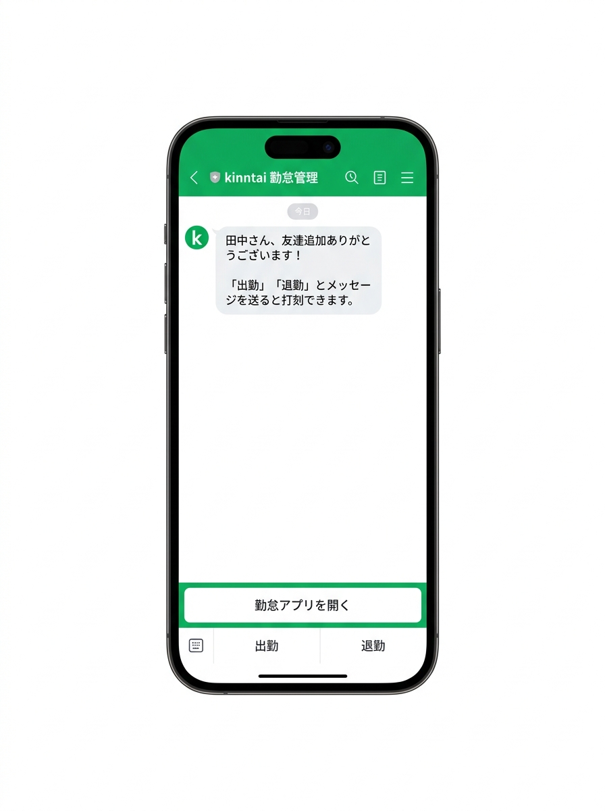
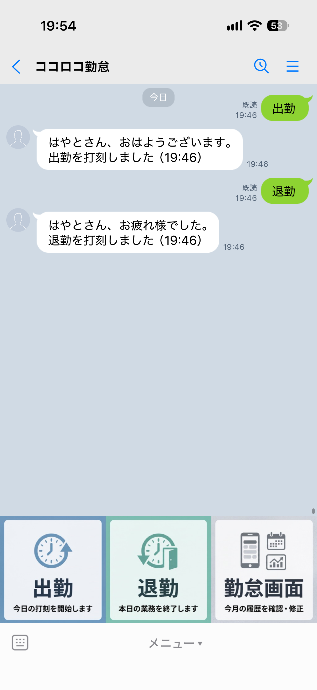
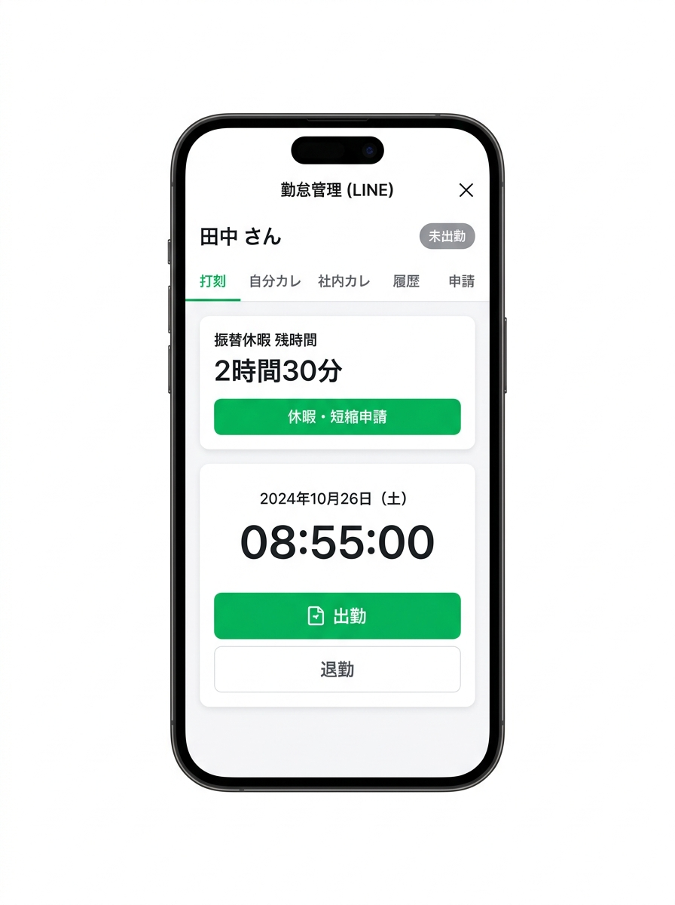
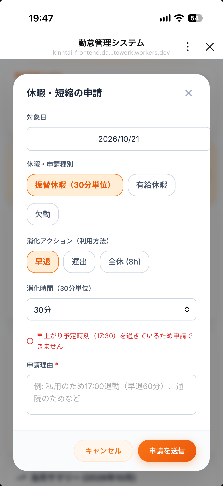
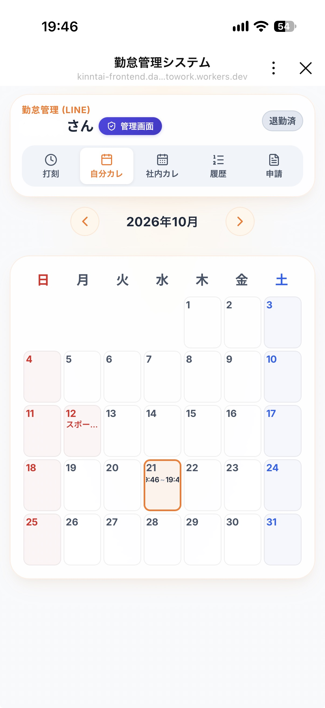

# LINEでかんたん勤怠管理 使い方ガイド（従業員向け）

このガイドでは、LINEを使った毎日の出勤・退勤の打刻や、お休みの申請方法について説明します。
専用アプリのダウンロードや、ID・パスワードの入力は必要ありません。普段使っているLINEの操作だけでかんたんに利用できます。

---

## 目次

1. はじめの準備（最初の1回だけ）
2. 毎日の打刻方法（トーク送信またはボタン）
3. ちょっと特別な日の打刻ルール（早出・早退・休憩）
4. お休みや早上がりの申請方法（有給・振替休暇・修正申請）
5. 自分の履歴やみんなの予定の確認（カレンダー）
6. よくある質問（困ったときは？）

---

## 1. はじめの準備（最初の1回だけ）

お店の勤怠システムへの参加は、LINE公式アカウントを友だち追加するだけで完了します。

1. お店の「LINE公式アカウント」を友だち追加します。
2. 追加されると、Botから自動的にあいさつメッセージが届き、あなたのLINE表示名が勤怠システムに登録されます。
3. トーク画面の下部に「出勤」「退勤」「勤怠画面」のリッチメニュー（常設メニュー）が表示されます。

---

## 2. 毎日の打刻方法

打刻の方法は2通りあります。ご自身の使いやすい方を選んでください。

### 方法A: LINEのトークで送る（一番おすすめ）
- 出勤するとき: トーク画面に「出勤」と送信します（またはリッチメニューの「出勤」をタップ）。
- 退勤するとき: トーク画面に「退勤」と送信します（またはリッチメニューの「退勤」をタップ）。

送信すると、Botから「〇〇さん、おはようございます。出勤を打刻しました（時刻）」のように確認メッセージが即座に届きます。

注意点と安心の機能:
- 二重打刻防止: 誤って続けて2回「出勤」を送ってしまっても、1回目の打刻時刻が保持され、二重に記録されることはありません。
- グループへの自動共有: 個別トークで打刻すると、店舗・チームの共有LINEグループにも「【出勤通知】〇〇さんが出勤しました（時刻）」と自動通知されるため、同僚や店長への個別の出勤連絡は不要です。

### 方法B: 画面のボタンを押す（勤怠アプリ）
1. LINE画面下のメニューから「勤怠アプリを開く」をタップします。
2. 画面に大きく表示されている「出勤」または「退勤」ボタンをタップします。
3. 今日の打刻時間や、今月たまっている振替休暇の時間がすぐに確認できます。

画面の見方:
- 画面上部: お名前と現在のステータス（「未出勤」「出勤中」など）が表示されます。
- 振替休暇 残時間: 現在たまっている代休の時間（例: 2時間30分）がひと目で分かります。
- リアルタイム時計: 今日の日付と現在時刻が表示されます。

---

## 3. ちょっと特別な日の打刻ルール

現場の就業基本時間（9:00〜18:00）と異なる場合の取り扱いルールです。

### 朝早く出勤したとき（早出）
- 8:30より前に出勤した場合:
  打刻時に「早出理由（例: 朝の荷受け作業のため、開店準備のため）」を入力する案内が出ますので、理由を一言入力してください。
- 8:30〜9:00の間に出勤した場合:
  理由の入力は不要です。通常通り打刻してください。
※9:00より前に働いた時間や、18:00以降の残業時間は、30分単位で自動的に「振替休暇（代休）」としてたまります。

### 予定より早く帰るとき（早退）
- 18:00より前に退勤する場合:
  退勤時に「早退理由（例: 体調不良のため、病院受診のため）」の入力が必要です。管理者が確認の上で承認します。

### 休憩時間について
- 休憩時間の打刻は不要です。
- 出勤から退勤までの拘束時間が6時間を超える場合は、システムが自動的に60分の休憩時間を差し引いて実労働時間を算出します。

### 就業ルールのまとめ表

| 状況 | 該当する時間帯 | 必要な対応 | 振替休暇の付与 |
| :--- | :--- | :--- | :--- |
| 通常出勤 | 8:30〜9:00 | 通常通り打刻（理由不要） | なし |
| 早出 | 8:30より前 | 打刻時に「早出理由」を入力 | 9:00前の勤務分を30分単位で付与 |
| 残業 | 18:00以降 | 通常通り「退勤」打刻 | 18:00以降の超過分を30分単位で付与 |
| 早退 | 18:00より前 | アプリから「早退理由」を入力して申請 | 管理者による承認が必要 |
| 休日出勤 | 土日・国民の祝日 | 通常通り出退勤打刻 | 実労働時間を30分単位で付与 |

---

## 4. お休みや早上がりの申請方法

画面下のメニューから「勤怠アプリ」を開き、画面内の「休暇・短縮申請」ボタン、または上部タブの「申請」から行います。

### たまった振替休暇（代休）を使いたいとき
早出や残業、休日出勤でたまった時間は、以下のように使えます。
1. 申請画面で「振替休暇（30分単位）」を選びます。
2. 希望する使い方（消化アクション）を選びます。
   - 早退: 予定より早く帰る（例: 30分早上がりなら、当日の17:30までに申請）。
   - 遅出: 朝少し遅れて出勤する。
   - 全休 (8h): 振替休暇が合計8時間分（480分）たまっている場合に、丸1日のお休みとして申請できます。
3. 理由を入力して「申請を送信」をタップします。

### 有給休暇を取りたいとき
1. 申請画面で「有給休暇」を選びます。
2. お休みしたい「対象日」を選びます。
3. 「申請を送信」をタップします。管理者が確認すると承認されます。

### 打刻を忘れた・間違えたとき（打刻修正申請）
「昨日の退勤を押し忘れて帰ってしまった」「出勤時刻を間違えた」ときは、画面内の「修正申請」から正しい時間を入力して申請してください。管理者が承認するとデータが修正されます。

---

## 5. 自分の履歴やみんなの予定の確認

勤怠アプリの上部タブから、いつでもカレンダーや過去の履歴を確認できます。

### 自分カレンダー（「自分カレ」タブ）
- 月ごとのカレンダー形式で、日ごとの出勤・退勤実績が表示されます。
- 日付をタップすると、その日の「出勤時刻」「退勤時刻」「実働時間」の詳細が表示されます。
- 日本の祝日や振替休日も自動で色分け表示されます。

### 社内カレンダー（「社内カレ」タブ）
- お店の全体行事や、他のスタッフのお休み予定などを一覧で確認できます。

---

## 6. よくある質問（困ったときは？）

Q. 休憩時間は自分で入力する必要がありますか？

A. いいえ、入力不要です。拘束時間が6時間を超える場合は、自動的に60分の休憩が差し引かれて実労働時間が計算されます。

Q. スマホを機種変更したらどうなりますか？

A. 新しい端末で同じLINEアカウントを引き継いでいれば、再設定は一切不要でそのまま使い続けられます。

Q. 出勤の打刻を忘れて仕事を始めてしまいました。

A. 気づいた時点で一度「出勤」を打刻してください。その日の夜または後日、アプリ内の「修正申請」から実際の出勤時刻を申請していただければ管理者が承認して修正できます。

Q. 自分の振替休暇があと何時間残っているか確認したいです。

A. 勤怠アプリを開くと、上部のカードに「振替休暇 残時間: 〇時間〇分」と大きく表示されています。

Q. 送信した申請を取り消したいです。

A. 申請タブの「申請履歴」から該当の申請を確認できます。管理者が承認する前であれば取り消しや再申請が可能です。
